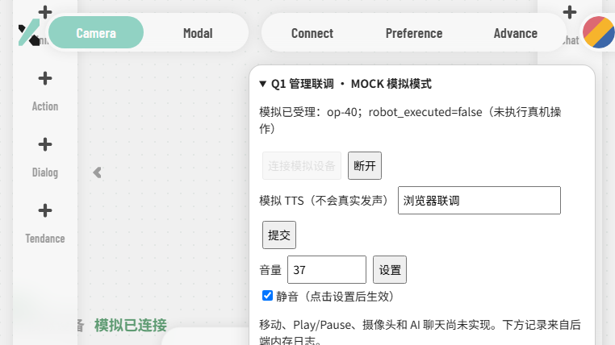

# 前后端联调说明

日期：2026-10-26。开发完全在Ubuntu，Windows管理系统开发目录只保留docs副本。

## 目录与来源

```text
~/primebot_ws/PrimebotX/          当前整合项目，原有Git配置保留
  backend/                    C++17 HTTP后端
  frontend/                   PrimebotX前端 + js/integration.js API适配
  scripts/run_local.sh        同源启动入口
  docs/                      文档
~/primebot_ws/q1-sdk-official/aimdk_msgs/   当前SDK消息定义（直接使用官方仓库）
~/primebot_ws/q1-sdk-official/  本次从GitCode下载的官方SDK
```

前端来源 https://github.com/HiKLPA/PrimebotX.git 。本次以用户克隆的正式仓库为整合入口，保留原 `.git`、origin远程和提交 `d222ab0`。已核对ZIP中未修改的前端文件与克隆仓库一致，再迁入API适配。前端文件从仓库根目录移动到frontend，加入backend/scripts/docs。本次没有提交、推送或修改远程地址，所有改动可用git diff检查；文件重命名由Git在后续暂存时识别。

旧的 `~/primebot_ws/project` 已移至 `~/primebot_ws/back/project`，后续只开发 `~/primebot_ws/PrimebotX`。新后端构建目录为 `~/primebot_ws/backend-build-primebotx`，避免复用指向旧源码的CMake缓存。

## 启动

Ubuntu终端执行：

```bash
export PRIMEBOT_WORKSPACE="$HOME/primebot_ws"
cmake -S "$HOME/primebot_ws/PrimebotX/backend" -B "$PRIMEBOT_WORKSPACE/backend-build-primebotx" -G Ninja
cmake --build "$PRIMEBOT_WORKSPACE/backend-build-primebotx" -j2
ctest --test-dir "$PRIMEBOT_WORKSPACE/backend-build-primebotx" --output-on-failure
bash "$HOME/primebot_ws/PrimebotX/scripts/run_local.sh"
```

Windows浏览器打开 http://localhost:8080/ 。保持Ubuntu服务终端运行，Ctrl+C停止。

【换电脑需改】发行版名、项目和工作区位置以实际为准；脚本自动定位project，PRIMEBOT_WORKSPACE指向构建目录所在工作区。端口占用时用 `PORT=8081 bash .../run_local.sh`，浏览器同步改8081。本服务只监听127.0.0.1，另一台电脑不能直接连；本机WSL localhost转发仍需各电脑验证。不直接双击HTML，不额外使用其他端口静态服务器。

## 可以演示什么

| 界面操作 | 实际接口与结果 |
|---|---|
| 联调面板“连接模拟设备”或Connect弹窗Confirm | POST /api/v1/connections，仅q1-mock；不会连接机器人 |
| 断开 | DELETE /api/v1/connection，电量显示-- |
| 左下设备状态和电量 | 每2秒读取/status；已连接时56%，标记模拟；信号未提供，显示弱化 |
| Action的挥手/比心/加油 | 动作来自/capabilities；POST /actions返回simulated，不执行动作 |
| 联调面板TTS | POST /tts；模拟受理，不发声 |
| 联调面板音量/静音 | PUT /audio；状态保存在服务内存中 |
| 面板日志和右侧Log | GET /logs；只显示本后端操作记录 |
| Chat、移动、Play/Pause、Dialog/Tendance | 明确未实现；聊天预设回复已停用，未绑定成TTS |

请求统一使用相对路径/api/v1；写请求自动带随机Idempotency-Key；错误直接显示后端消息。连接状态以后端返回为准，不以按钮动画作为成功依据。联调面板用于补足原界面缺少的TTS/音量控件，后续前端同学可把这些控件融入正式UI。

## 与前端同学的协作方式

现以同学的PrimebotX仓库为统一项目，保留前端历史和origin。前端同学后续编辑frontend，后端编辑backend，共享docs和/api/v1约定；原根目录HTML已移到frontend，不能继续按旧路径打开。首次提交前需核对本地差异、所选分支和协作者写权限，本次不提交或推送。

## 后续验证

优先核验机器人网络与DDS发现，再用官方SDK逐项验证状态、TTS、音量和动作，最后实现后端Ros2Adapter并进行网页到真机测试。移动需另外验证停止、失联和控制权，不因本次UI接通而开放。摄像头、AI聊天、任务队列和持久化属于后续功能。


## 本机验证结果

- C++重新构建通过，CTest API集成测试1/1通过。
- Windows curl通过localhost访问WSL后端健康接口。
- Windows无界面Chromium实际打开同源页面，点击模拟连接、挥手动作、TTS、设置音量37并静音、断开；校验后端状态和日志、断开后电量--，全部通过。
- 移动、Play/Pause和聊天输入禁用状态通过；最终浏览器测试无未捕获页面异常。
- 本次修复了动态替换卡片时原有吸顶动画保留已删除标题引用的问题，改为保留标题节点。
- 原有API测试保持通过；上述验证没有连接机器人，也没有在另一台电脑复测。


