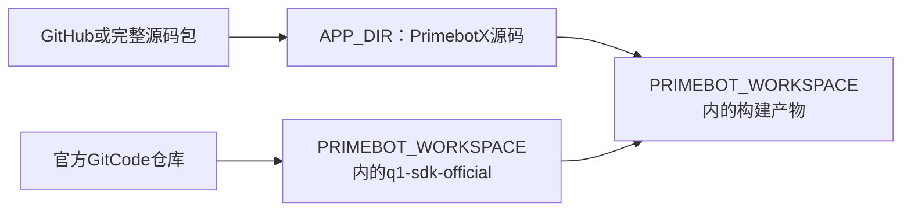

# 文档1：完全在 Ubuntu 中配置和构建工作区

适用Windows WSL2、Ubuntu22.04、ROS2 Humble；x86_64已验证。源码、依赖、编译结果都放Linux文件系统；Windows的管理系统开发目录只保留文档，开发源码只放Ubuntu。以下代码块分别注明运行终端。

## 1. 安装 Ubuntu22.04（Windows PowerShell）

```powershell
wsl --version
wsl --install -d Ubuntu-22.04 --location D:\WSL\Ubuntu-22.04 --web-download
wsl --list --verbose
wsl -d Ubuntu-22.04
```

【换电脑需改】D:\WSL\Ubuntu-22.04是安装位置，可换有空间的本地磁盘；注册名以wsl列表为准。WSL旧版本不支持location时先更新WSL。初次启用可能要求管理员及重启。已安装者跳过安装，勿覆盖或注销已有系统。

首次启动按提示创建自己的Linux用户名和密码。当前电脑已有truth用户；如果未设置密码，在PowerShell运行 `wsl -d Ubuntu-22.04 -u root -- passwd truth`，其他电脑替换用户名。

## 2. 获取源码（Ubuntu终端）

先运行 `cat /etc/os-release`，确认VERSION_ID=22.04。本文第2～6节统一使用以下目录；每个新Ubuntu终端先执行：

```bash
export PRIMEBOT_WORKSPACE="$HOME/primebot_ws"
export APP_DIR="$PRIMEBOT_WORKSPACE/PrimebotX"
```

PRIMEBOT_WORKSPACE是工作区，APP_DIR是其中的项目仓库。$HOME自动取当前Linux用户的家目录，无需替换truth。换电脑如需调整工作区，只修改第一行，保持第二行不变。所有源码和构建产物都放Ubuntu文件系统，不放/mnt下。

当前电脑已准备好项目和SDK，跳过以下导入操作，不要重复克隆或覆盖现有修改。新电脑按方式A或B导入项目，再单独获取SDK。

### 方式A：从GitHub克隆项目

```bash
# git尚未安装时先执行：sudo apt-get update && sudo apt-get install -y git
mkdir -p "$PRIMEBOT_WORKSPACE"
# 目标必须不存在；已有仓库时跳过clone，先检查其中内容。
test ! -e "$APP_DIR" || { echo '项目目录已存在，请先检查'; exit 1; }
git clone https://github.com/HiKLPA/PrimebotX.git "$APP_DIR"
```

【需核对】地址是团队前端仓库；本机整合改动尚未提交或推送。当前直接克隆远程只能获得远程已提交的内容，不能自动获得本机backend/scripts等改动。整合版本发布后再按此方式复现；发布前使用方式B导入完整源码包。私有仓库需要先完成认证。

### 方式B：从Windows复制完整源码包

```bash
# 【需改】源目录必须包含backend/frontend/scripts/docs。
# 当前Windows“管理系统开发”目录只有docs，不能用作源码来源。
IMPORT_APP='/mnt/d/你的源码交付包/PrimebotX'
test -f "$IMPORT_APP/backend/CMakeLists.txt" || { echo '请选择完整整合源码包'; exit 1; }
mkdir -p "$PRIMEBOT_WORKSPACE"
test ! -e "$APP_DIR" || { echo '项目目录已存在，请先检查'; exit 1; }
cp -a "$IMPORT_APP" "$APP_DIR"
```

【需改】主机盘符对应/mnt/d、/mnt/e等；只替换IMPORT_APP实际来源，不改变目标APP_DIR。交付源码包不包含旧build/install等构建结果。

### 单独获取Q1 SDK

```bash
mkdir -p "$PRIMEBOT_WORKSPACE"
# 已有SDK目录时跳过clone，核对版本，不覆盖。
git clone https://gitcode.com/primebot/q1-sdk.git "$PRIMEBOT_WORKSPACE/q1-sdk-official"
git -C "$PRIMEBOT_WORKSPACE/q1-sdk-official" rev-parse HEAD
test -f "$PRIMEBOT_WORKSPACE/q1-sdk-official/aimdk_msgs/package.xml"
```

当前SDK版本为7310314eee058323a2c15ab1f4f947df4112573e。构建直接使用此仓库中的aimdk_msgs，不复制消息包、不创建src。真机使用前核对固件和接口。构建脚本只构建消息包，不构建全部官方示例。

## 3. 安装依赖（Ubuntu终端）

在已设置上述两个变量的Ubuntu终端执行：

```bash
test -f "$APP_DIR/scripts/setup_ros_humble.sh" || { echo '请确认APP_DIR指向完整整合源码'; exit 1; }
sudo apt-get update
sudo apt-get install -y build-essential cmake ninja-build pkg-config git curl ca-certificates gnupg locales software-properties-common python3-pip libcpp-httplib-dev nlohmann-json3-dev
sudo bash "$APP_DIR/scripts/setup_ros_humble.sh"
```

脚本适用22.04，配置ROS官方源并安装Humble、FastDDS和colcon，不要在26.04上强改jammy源。网络需访问Ubuntu源、packages.ros.org与ROS密钥地址。软件源会更新，本机已验证版本见 `$APP_DIR/docs/environment-evidence.txt`；本文不是冻结的二进制镜像。仅安装依赖使用sudo，后续构建不使用sudo。

## 4. Linux工作区结构和构建

使用默认变量时，目录对应关系如下：

```text
$PRIMEBOT_WORKSPACE/                 即 ~/primebot_ws
├─ PrimebotX/                        即 $APP_DIR，Git项目仓库
│  ├─ backend/                       C++后端源码与测试
│  ├─ frontend/                      前端源码和API适配
│  ├─ scripts/                       安装、构建和启动脚本
│  └─ docs/                          文档和验证记录
├─ q1-sdk-official/                  独立的官方SDK仓库
│  └─ aimdk_msgs/                    本次构建的消息包
├─ backend-build-primebotx/          后端构建产物
├─ build/                           SDK构建中间文件
├─ install/                         SDK消息库和环境脚本
├─ log/                             SDK构建日志
├─ evidence/                        本机验证记录
└─ back/project/                    本机旧项目归档；新电脑无需创建
```

```bash
test -f "$APP_DIR/backend/CMakeLists.txt"
test -f "$PRIMEBOT_WORKSPACE/q1-sdk-official/aimdk_msgs/package.xml"
bash "$APP_DIR/scripts/build_workspace.sh"
```

脚本自动定位APP_DIR下的源码，读取PRIMEBOT_WORKSPACE决定构建位置；colcon只扫描 `$PRIMEBOT_WORKSPACE/q1-sdk-official` 并选择aimdk_msgs。不再设置Q1_SDK_DIR，不创建跨Windows源码链接。脚本拒绝/mnt下的源码和工作区。

切换源码路径时不能沿用指向旧路径的CMake缓存。当前已经清理并重建；新电脑按本文布局重新构建。即使WSL的ext4.vhdx存于D盘，家目录中的文件仍位于Linux文件系统。



## 5. 验证（Ubuntu终端）

继续使用第2节设置的变量；换新终端时先重新执行那两行export。

```bash
ctest --test-dir "$PRIMEBOT_WORKSPACE/backend-build-primebotx" --output-on-failure
source /opt/ros/humble/setup.bash
source "$PRIMEBOT_WORKSPACE/install/setup.bash"
ros2 interface show aimdk_msgs/srv/PlayTts
python3 "$APP_DIR/scripts/verify_ros_local.py"
```

/opt/ros/humble是ROS依赖的标准安装路径，不是项目目录，无需改成APP_DIR。其余项目路径均从两个变量取得。预期后端测试通过、PlayTts字段可显示、本机BMS百分比42收发成功。验证脚本仅在自身进程设置域177及localhost-only；这些参数不能照搬到真机连接终端。本节不代表完成真机验证。

## 6. 编辑、更新和跨电脑协作

所有项目修改都在 `$APP_DIR` 中进行：后端为 `$APP_DIR/backend`，前端为 `$APP_DIR/frontend`，文档为 `$APP_DIR/docs`。官方SDK位于 `$PRIMEBOT_WORKSPACE/q1-sdk-official`，与管理系统仓库分开管理。`$PRIMEBOT_WORKSPACE/back` 是归档，不继续开发，不参与构建，也不属于管理系统Git仓库；仓库规则另外忽略back/。

使用VS Code的WSL模式打开 `$APP_DIR`。Windows资源管理器对应路径示例为 `\\wsl.localhost\Ubuntu-22.04\home\truth\primebot_ws\PrimebotX`；【需改】发行版、Linux用户名和工作区以实际配置为准。该Windows路径只是浏览Ubuntu文件的入口，不是另一份源码。

Windows“管理系统开发”目录只保留docs副本，文档不会自动同步。修改Ubuntu文档后，可在Ubuntu终端复制更新：

```bash
# 【需改】仅修改Windows文档副本的目标位置。
WINDOWS_DOCS='/mnt/d/启元机器人/管理系统开发/docs'
mkdir -p "$WINDOWS_DOCS"
cp -a "$APP_DIR/docs/." "$WINDOWS_DOCS/"
```

团队代码协作使用APP_DIR内的Git仓库，按授权提交和推拉；SDK仓库单独记录版本。新电脑重新设置相同形式的两个变量，按第2～5节导入、安装、构建、验证，不复制旧的构建缓存或归档。

colcon的--symlink-install可能产生Ubuntu内部安装链接，它不指向Windows源码，与已移除的跨文件系统源码链接不同。

## 7. 本机验证结果和限制

- 已在Ubuntu22.04.5、GCC11.4、CMake3.22、Python3.10环境验证。
- Linux实体源码工作区重新构建，后端CTest1/1通过，aimdk_msgs编译通过，本机隔离ROS消息验证通过。
- 旧的primebot_ws_windows_links_backup已删除；当前Linux源码与SDK为实体目录。
- 没有测量前后编译速度，不给出加速比例；改善的是文件访问路径。
- 未验证另一台电脑，也未验证真机网络和SDK业务调用。更换电脑需按第5节实际测试。
- 尚未构建所有官方示例；WSL网络NAT/镜像模式、DDS发现和真实资源支持仍需现场核实。测试步骤见文档3。

## 8. GitHub提交准备（Ubuntu终端）

仓库根目录包含.gitignore、.gitattributes、.editorconfig。忽略构建结果、个人凭据、IDE缓存和压缩备份；统一脚本LF换行。docs中的环境记录可以分享，但提交前仍检查机器名/路径等个人信息。SDK不在本仓库内。

新Ubuntu不自动继承旧系统或Windows的Git账号。提交身份与远程认证是两件事：

```bash
cd "$APP_DIR"
# 【需改】真实姓名和GitHub验证邮箱，或自己的GitHub noreply邮箱；仅配置本仓库。
git config user.name '你的提交姓名'
git config user.email '你的提交邮箱'
git status --short
git diff --check
# 以下在确认提交内容并获准发布后执行，本次未执行：
# git add README.md backend scripts docs .gitignore .gitattributes .editorconfig
# git commit -m "Initialize Q1 management backend"
# git remote add origin <你的GitHub仓库地址>
# git push -u origin main
```

GitHub HTTPS推送需要令牌/凭据管理器，或使用SSH密钥认证；不要将令牌写入远程URL，不要提交私钥。用户已自行配置Git提交身份；本次未修改身份、未配置远程地址、未提交或推送，也未验证推送认证。建议本人完成认证，不通过聊天发送密码或令牌。

## 9. 前后端整合与启动

详见[前后端联调](./前后端联调.md)。当前源码布局为 `PrimebotX/backend + PrimebotX/frontend`，同一个C++服务同时提供静态页面和API。Ubuntu执行：

```bash
bash "$HOME/primebot_ws/PrimebotX/scripts/run_local.sh"
```

Windows浏览器访问 http://localhost:8080/ 。【需改】其他目录设置PRIMEBOT_WORKSPACE并使用实际脚本路径；端口占用时 `PORT=8081 bash .../run_local.sh`，浏览器对应改为8081。不要直接双击HTML，也不要另开Python静态服务器，否则不再是同源API路径。


## 10. APP_DIR 与 PRIMEBOT_WORKSPACE

在Ubuntu终端中，APP_DIR指向项目源码仓库；PRIMEBOT_WORKSPACE指向本机工作区。二者可以是不同目录，不能互换：

```bash
export PRIMEBOT_WORKSPACE="$HOME/primebot_ws"
export APP_DIR="$PRIMEBOT_WORKSPACE/PrimebotX"
bash "$APP_DIR/scripts/build_workspace.sh"
bash "$APP_DIR/scripts/run_local.sh"
```

APP_DIR只是文档中的路径变量，用于定位源码和脚本；脚本本身会根据自身位置定位仓库，因此直接写完整脚本路径时可不设置APP_DIR。PRIMEBOT_WORKSPACE由脚本读取，决定SDK消息包和构建结果的位置；未设置默认$HOME/primebot_ws。export仅对当前终端及其子进程有效。换电脑时按实际目录修改；不要使用sudo构建。

`q1-sdk-official/aimdk_msgs`是当前colcon构建的消息包。SDK说明和示例也位于q1-sdk-official；工作区不再保留src副本。旧project位于back/project，旧backend-build和SDK旧构建缓存已清理。back在Git仓库之外，另外仓库.gitignore也忽略back/；归档目录含COLCON_IGNORE，不参与colcon扫描。
