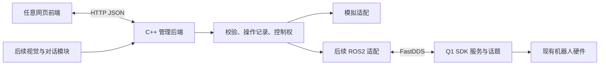

# 文档2：Q1 管理系统独立需求分析

日期：2026-10-26。状态：本轮开发基线；取代旧版中按 PrimebotX 控件推导的范围。既有前端可按此方案调整。

## 1. 产品目的

复现企业操控 App 的核心使用体验：连接机器人、了解状态、控制动作与交互、查看画面和排查错误。先连接现有 Q1，再基于相同业务接口增加自研感知、智能对话与场景编排。

这里的“复现”指实现同等类别的可用功能，不意味着复制官方账号系统、源码或未开放协议。SDK 中未证明存在的接口列入差距清单，不能承诺仅凭现有 SDK 完成全部官方 App 功能。

## 2. 谁在什么情况下使用

| 用户 | 需求 | 完成后的体验 |
|---|---|---|
| 调试同学 | 判断连接和设备状态 | 看到业务接口是否可用、各数据更新时间和错误原因 |
| 操作同学 | 手动控制机器人 | 选择动作、输入播报文字、调音量、按住移动并松手停止 |
| 演示人员 | 稳定展示固定流程 | 一键启动已保存的场景，看到步骤和执行结果 |
| 算法同学 | 把感知或 AI 结果变成机器人行为 | 调用统一业务接口，无需各自重复实现 SDK 控制 |

## 3. 架构

当前最小程序只实现图中的模拟分支。ROS 分支是下一步工作，安装或编译 SDK 不等于业务后端已接入 SDK。硬件复刻后的驱动和底层运控由对应负责人提供，后端通过适配边界接入。

## 4. 分成四层交付

| 层次 | 功能 | 本次状态 |
|---|---|---|
| M0：可运行后端骨架 | HTTP、JSON、模拟连接/状态/播报/音量/动作、记录、参数校验、请求去重 | 本次实现和测试范围 |
| M1：现有 Q1 基础操控 | 真机连接、电量、TTS、音量静音、表情灯语、预设动作、运动模式、移动与停止 | 需求明确，尚未真机接入 |
| M2：管理体验完善 | 摄像头截图与实时画面、资源配置、触摸/ASR展示、日志导出、快捷指令分类与收藏 | 后续复刻范围 |
| M3：二次开发 | 自研模型对话、手势触发、场景编排、动作学习、个性化陪伴 | 基础操控稳定后逐项建设 |

这样既不把普通控制说成创新，也不把模拟接口说成真机成果。

## 5. 基础功能定义与验收

| 模块 | 明确行为 | 验收依据 |
|---|---|---|
| 设备档案 | 单机器人地址、昵称、版本、配置引用 | 档案由配置管理；不虚构扫描结果 |
| 连接 | 检查 SDK 业务服务及状态流，显示检查中/就绪/部分可用/断连 | ping 通不能单独视为连接成功 |
| 电量 | Bms.remaining_capacity_percentage、采集时间、过期提示 | 与真机消息一致；无数据返回未知 |
| TTS | 用户输入文字，机器人播报，可选是否打断 | 请求结果与现场声音分别核验 |
| 音量/静音 | 读取、修改、回读 | 分服务报告结果；部分失败不报全成功 |
| 动作 | 后端维护机型资源白名单，执行并显示结果 | GetMcAction/SetMcPresetMotion 等真实调用和现场核验 |
| 表情/灯语 | 选择已核实资源、执行 | 对照 PlayEmotion、灯语服务和实机资源 |
| 移动 | 前进/后退/左侧移/右侧移/左转/右转分为六个明确控件 | 不再要求一个左右键同时表示两种动作 |
| 停止 | 按钮释放/失焦/续发超时清除移动目标，尝试零速度 | 逐项测量停止行为；与物理急停分开 |
| 摄像头 | 先 JPEG 截图，再 RTSP 转网页媒体 | 画面有效、方向正确；测量延迟，不伪造实时流 |
| 操作日志 | 请求ID、时间、来源、目标、结果/原始码 | 可复现一次失败，不等同官方完整系统日志 |

移动控件语义是本方案提出的产品定义：侧移与转向分开。前端旧的斜向和 Play/Pause 不构成需求；首期不提供含义不明的控制。运动接口实际开放需先验证模式、输入源、速度配置和超时机制。

## 6. 快捷指令与聊天

快捷指令是“保存好的操作模板”，分类可为动作、播报、表情、场景。类型由数据定义，前端标签可以修改，不固定使用 Dialog/Tendance。收藏属于用户配置。第一批动作候选来自 Q1 常量（挥手3004、比心3007、加油3008），真机核验后才开放。

Chat 的目标是文字对话，不等同 TTS。后续由管理后端对接组内模型服务，支持消息、会话和回复；“是否让机器人播报回复”是独立选项。LLM 不直接输出电机命令，只可提出有限白名单行为，由执行模块校验。当前不实现聊天和假回复。

场景编排先支持顺序步骤、等待、失败中断和取消后续步骤。并行、精准音画同步、AI 实时改剧本都不作为首批目标。只有明确执行完成反馈后才宣称步骤真实完成。

## 7. 非功能需求

- 初期后端仅监听本机127.0.0.1；开放局域网前增加认证、控制会话与来源限制。当前无认证版本不能直接暴露给多人控制。
- 模拟/真机模式显著区分；每项能力独立显示可用/禁用及原因。
- 写请求去重，超时结果不确定时不自动重试；请求受理、提交、实际完成分开。
- 所有速度带单位，边界与输入源优先级来自已验证配置，不能照抄示例80优先级或把极低非零速度当安全值。
- 后端崩溃/链路中断时不能承诺仍发出停止；必须核验机器人自身的超时脱锁和停止行为。
- 先单设备、单操作人员，暂不增加多机器人、多租户、复杂数据库或微服务。

## 8. 官方功能差距

官方配网、登录绑定、OTA、标定、技能市场与技能部署暂不实现，保留官方工具完成。当前公开 SDK 未证明提供完整等价接口。运动支持、资源列表和媒体能力以本机固件为准。自动扫描、无线信号强度、动作结束回调也不能凭界面推定存在。

## 9. 分工与后续顺序

用户负责完整管理后端与 SDK 适配；夏渝杰后续按本需求修改页面。设备负责人提供实际网络、固件、开发模式与测试条件；硬件负责人处理新硬件驱动。

顺序：本机模拟闭环 → SDK构建和本机ROS测试 → 真机只读 → 音频 → 表情灯语与动作 → 控制权/移动/停止 → 媒体 → 快捷模板/场景 → 算法联动。

本方案独立于既有前端，不要求旧的四个控件问题全部答完才能准备环境。没有实机条件的项目在文档3逐项标为未验证。

## 10. 依据

本地 SDK 的 README、接口说明、aimdk_msgs 定义与 C++ 示例；1.2 App 体验第3至6节；1.6、1.8；多模态项目研究说明。App 体验含静态分析和待验证条目，不等于全部功能真机可用。
