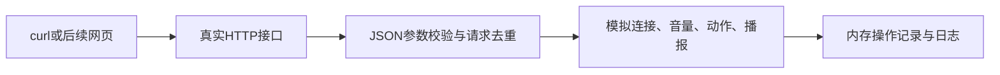
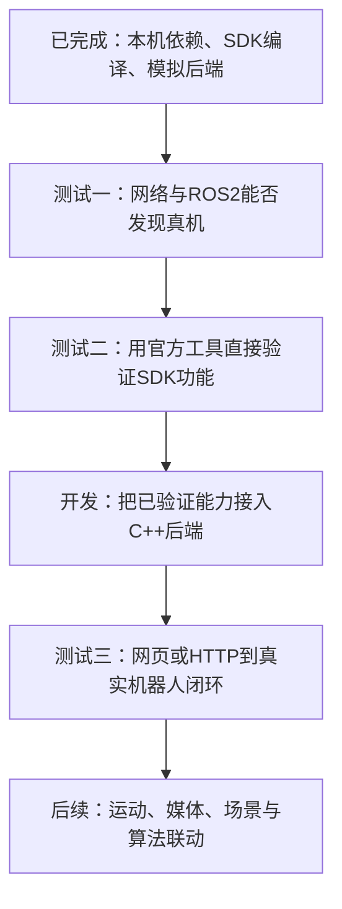

# 文档3：最小后端功能、验证和后续方向

日期：2026-10-26。版本0.1.0。程序是已经构建和测试的C++模拟服务；尚未接入真机，不能操控现有Q1。

## 1. 当前完成什么



| 功能 | 已实现行为 | 不代表什么 |
|---|---|---|
| 健康检查 | 返回版本和mock标识 | 不代表机器人在线 |
| 模拟设备/连接 | q1-mock连接、断开、状态查询 | 不扫描或连接真实设备 |
| 电量 | 连接后返回56%，来源mock；断开null | 不是实际电量 |
| 播报 | 校验1至300字符、生成模拟操作 | 不会实际发声 |
| 音量和静音 | 读取/修改内存值，校验类型范围 | 不调用音频SDK |
| 动作 | 挥手/比心/加油三个白名单ID | 不执行机器人动作，常量仅作映射候选 |
| 请求去重 | 同键同请求返回原结果，同键不同内容409 | 不保证重启后恰好执行一次 |
| 日志/操作 | 内存查询、增量游标、淘汰提示 | 不是持久数据库或官方系统日志 |
| 明确禁用能力 | ROS2模式、移动、表情、摄像头、聊天返回422 | 未实现功能不伪装成功 |

动作常量来自当前SDK，不代表已核实本体支持。所有模拟操作返回state=simulated、mode=mock、robot_executed=false。

## 2. 如何启动和演示

### 换电脑时的适配点

先按文档1在目标电脑安装依赖并重新构建，不复制本机可执行文件作为通用安装包。

当前源码位于Ubuntu实体目录：本机APP_DIR=~/primebot_ws/PrimebotX；新电脑可克隆或复制到~/primebot-manager。文档位于APP_DIR/docs，SDK位于~/primebot_ws/q1-sdk-official/aimdk_msgs。不再通过Windows源码软链接构建；Windows管理系统开发目录仅保留docs，开发以Ubuntu源码为准，协作用Git交换代码。

| 配置 | 本机示例 | 在其他电脑上怎么改 |
|---|---|---|
| WSL发行版与用户 | Ubuntu-22.04、truth | 改为实际注册名和Linux用户名，或使用默认用户省略-u |
| 工作区 | ~/primebot_ws | 若构建时设置PRIMEBOT_WORKSPACE，启动和CTest路径必须同步替换 |
| 服务端口 | 8080 | 被占用时用--port 8081等，所有curl地址同步修改 |
| 访问地址 | 127.0.0.1 | Ubuntu内部直接访问；Windows localhost转发需在该机验证 |
| 编译平台和依赖 | Ubuntu22.04 x86_64、系统库 | 其他架构/系统需重新验证，CMake依赖查找通过才继续 |
| robot_id | q1-mock | 这是程序内唯一模拟档案，不能改成真机IP期待连接 |
| 动作资源ID | 当前SDK的Q1常量候选 | 接真机后按型号/固件/SDK版本核对，不能照搬其他机型 |

后台只监听本机127.0.0.1，因此另一台电脑不能直接访问这台WSL服务。现已支持同源托管frontend；使用run_local.sh启动后浏览器和API共用8080，无需CORS。单独打开HTML或使用其他端口仍不属于当前支持的联调方式。不要为“能访问”直接开放无认证的全网监听。

Windows进入：

```powershell
wsl -d Ubuntu-22.04 -u truth
```

Ubuntu启动：

```bash
bash "$HOME/primebot_ws/PrimebotX/scripts/run_local.sh"
# 仅启动API仍可用 ~/primebot_ws/backend-build-primebotx/primebot_backend --port 8080
```

另一个Ubuntu终端执行：

```bash
curl http://127.0.0.1:8080/api/v1/health
curl -X POST http://127.0.0.1:8080/api/v1/connections -H 'Content-Type: application/json' -H 'Idempotency-Key: demo-connect-1' -d '{"robot_id":"q1-mock","mode":"mock"}'
curl http://127.0.0.1:8080/api/v1/status
curl -X POST http://127.0.0.1:8080/api/v1/tts -H 'Content-Type: application/json' -H 'Idempotency-Key: demo-tts-1' -d '{"text":"欢迎参观我们的项目","interrupt":false}'
curl -X POST http://127.0.0.1:8080/api/v1/actions -H 'Content-Type: application/json' -H 'Idempotency-Key: demo-wave-1' -d '{"action_id":"q1.wave"}'
curl http://127.0.0.1:8080/api/v1/logs
```

退出按Ctrl+C。服务仅监听127.0.0.1，无认证和CORS，未用于局域网多用户。为运行示例不需后台常驻。Windows可尝试curl.exe访问localhost；Windows localhost到WSL的HTTP健康检查已通过；页面操作验证和复现步骤见前后端联调文档。

## 3. 已实现接口（以本表为准）

所有路径前缀/api/v1。写操作需Idempotency-Key，最长128字节；重复键保留10分钟，最多10000项。请求体上限8192字节。JSON错误返回400，能力未实现422，未连接503。JSON包含request_id、data、error。

| 方法 | 路径 | 行为 |
|---|---|---|
| GET | /health | 后端健康 |
| GET | /robots | 模拟设备目录 |
| POST | /connections | 仅接受robot_id=q1-mock、mode=mock |
| GET / DELETE | /connection | 查询/断开 |
| GET | /status | 模拟状态 |
| GET | /capabilities | 动作白名单及不可用能力 |
| POST | /tts | text、interrupt |
| GET / PUT | /audio | volume整数0~100、muted布尔；至少一项 |
| POST | /actions | action_id=q1.wave/q1.heart/q1.cheer |
| GET | /operations/{id} | 查询单个模拟操作 |
| GET | /logs?after_id=0&limit=100 | 最近1000条日志内分页，limit1~200 |

操作记录达到1000项后清空旧操作，查询返回404；日志独立保留最近1000条。进程重启全部清空。返回状态simulated是本版契约；未来真机状态另行增加submitted等，不能让前端把所有200都解释为机器人执行成功。生产版本应改为稳定的持久化和淘汰策略。

旧“阶段1接口草案”是历史规划，不是实现清单；以文档2为需求、本文为当前能力，避免前端调用未实现端点。

## 4. 已完成的测试

```bash
ctest --test-dir ~/primebot_ws/backend-build-primebotx --output-on-failure
```

实际结果：1/1集成测试通过，约0.18秒。测试启动真实本地HTTP进程，覆盖：连接生命周期、mock标签、拒绝ros2模式、未连接写操作、无效JSON、空白/超长文本、未知动作、音量边界和类型、参数错误时不部分修改、相同键去重、不同内容冲突、日志无重复、禁用运动/相机、断开后拒绝控制。

SDK另外完成aimdk_msgs编译、PlayTts类型解析、本机合成BMS收发。未编译全套官方示例；未执行任何真机控制。

## 5. 尚未完成的连接与SDK测试

需要分别回答三个问题：**电脑能否连接机器人？官方SDK能否在这台机器人上实际工作？自己的管理后端能否正确调用这些能力？** 三者必须逐层验证。



### 测试一：电脑到底能不能连到机器人（当前未做）

先由设备负责人确认Q1型号、固件、开发模式、实际板卡IP及DDS域。10.1.1.100/101是文档默认值，不是所有电脑和机器人都固定如此。Windows有线地址、WSL网络模式、路由、防火墙和DDS网卡配置都可能因电脑不同而变化。

| 顺序 | 操作 | 通过标准 | 失败先查什么 |
|---|---|---|---|
| T1.1 | Windows和WSL分别ping实际板卡IP | 各自收到回复；若设备禁ICMP，另用允许的连通手段核实 | 网线、设备电源、地址、路由 |
| T1.2 | 加载ROS和SDK后查看节点、话题、服务 | 发现预期机器人业务接口，不只是/rosout和/parameter_events | 开发模式、域号、localhost-only、DDS网卡、多播/防火墙 |
| T1.3 | 订阅真实BMS状态 | 持续收到设备真实消息，确认来源并记录频率 | QoS、发布者、消息类型、版本 |

通过T1.1只说明网络路径，T1.2说明发现，T1.3进一步证明真实数据链路。WSL NAT下ping通但DDS不通仍属于连接问题，先解决它，不修改业务后端“绕过”。必要时评估镜像网络或厂商认可的显式发现配置。

### 测试二：SDK在这台真机上到底能不能用（当前未做）

先不经过自己的HTTP后端，使用匹配SDK的官方示例或原生ros2工具验证。这能把厂商能力/配置问题与我们代码的问题分开。

| 顺序 | 验证内容 | 通过标准与证据 |
|---|---|---|
| T2.1 只读 | 电量、当前模式；后续触摸/ASR | 获取真实值，记录类型、频率、QoS及原始输出 |
| T2.2 音频 | 固定句TTS；读取/设置/回读音量 | 不仅服务返回成功，现场听到正确播报，音量回读与设置一致 |
| T2.3 表情灯语 | 使用文档内已核实资源 | 服务结果与现场显示一致，记录可用资源和限制 |
| T2.4 预设动作 | 先核对模式、机型资源，再单个动作 | 真实执行且状态合理，区分“受理”与“完成”；失败保留SDK码 |
| T2.5 媒体 | 单帧JPEG，然后RTSP | 图像可解码、相机ID和方向正确；未到网页转接阶段 |

不是“SDK编译成功”就算全部可用，也不是某个TTS通过就算移动接口可用；每项功能独立标记。运动控制另设专项：先核验输入源和状态路径，再在现场保护条件下测速度范围、停止和失联行为。当前模拟后端仍拒绝运动，不直接用于该专项。

### 测试三：自己的管理后端是否真的接通（适配开发完成后做）

同一个已通过T2的功能，改为由HTTP请求驱动：例如POST /tts → Ros2Adapter → SDK → 真机播报 → 返回结果与日志。对比官方工具验证结果。

通过标准：请求输入和实际效果一致；SDK失败、未连接、超时能正确映射；重复提交不重复执行；状态过期有标记；模式和资源不支持时明确拒绝。最后才接网页，验证按钮、反馈及Windows到WSL的访问链路。

### 每次测试怎么记录

在工作区evidence下按“日期/测试编号”保存：电脑环境与网络配置、机器人型号/固件、SDK版本、命令或请求、原始输出、期望/实际、通过/失败/受限。只保存必要证据，不记录密码或令牌。

当前T1/T2/T3真机项均未执行，不能写成已通过；已完成的本机环境和模拟测试见第4节。

## 6. 后续开发任务

开发可以与现场测试交错进行，但真机功能开放前必须完成对应验证：

| 阶段 | 要开发什么 | 依赖/完成标准 |
|---|---|---|
| D1 适配结构 | 拆分HTTP、业务服务、RobotAdapter、MockAdapter；增加可选Ros2Adapter | 无机器人也能保持模拟测试通过 |
| D2 首条真机链路 | 连接探测、BMS订阅、TTS与音量服务 | T1和对应T2项通过；T3验证HTTP闭环 |
| D3 常用管理 | 表情、灯语、动作白名单、状态新鲜度和错误映射 | 每项SDK直调、后端调用分别通过 |
| D4 移动控制 | 认证、单控制会话、令牌、乱序拒绝、超时、模式守卫 | 专项验证松手/失焦/断连/进程崩溃时的机器人行为，不承诺软件停止等于物理急停 |
| D5 完整体验 | 截图、网页视频转接、资源配置、快捷模板、收藏、持久日志 | Windows网页到WSL到Q1联调通过 |
| D6 二次开发 | 场景、Chat服务、视觉触发；之后动作学习与个性化 | 基础执行可观测、可取消，模型只调用受限能力 |

最近的明确下一步是：**有机器人时先做T1和T2音频/只读验证；暂时没有机器人时先做D1，继续使用模拟测试。** 不用等待全部运动、媒体测试完成才开发第一条真机链路。

## 7. 对团队的意义

当前交付提供可构建、可调用、可自动验证的后端起点和清晰边界，前端可围绕稳定业务ID开发。完整企业App复刻仍需上述真机链路、SDK适配和媒体等工作；本版没有完成这些功能，不据此宣称机器人管理系统已具备实际操控能力。


## 8. 前端整合补充

已导入 PrimebotX 的用户下载 ZIP，增加同源静态服务、API适配和启动脚本；详见[前后端联调](./前后端联调.md)。浏览器中操作模拟连接、动作、TTS、音量和日志仍不经过SDK，不代表真机接入完成。SDK获取改为官方 https://gitcode.com/primebot/q1-sdk ，现直接使用该仓库中的消息包，旧src已删除。
