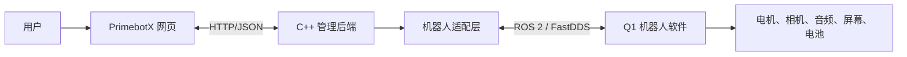
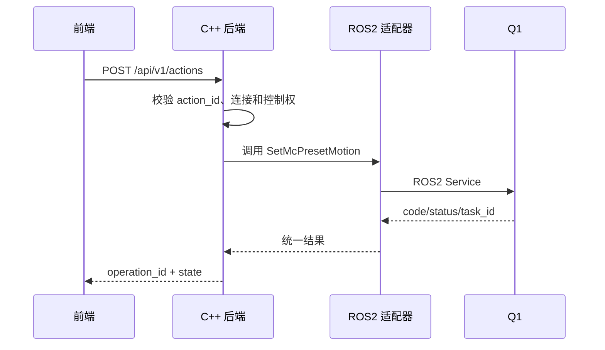

# Q1 管理系统第一阶段需求说明（评审版）

> 历史草案：2026-10-26起以《文档2_独立需求分析》为需求基线、《文档3_最小后端与后续工作》为实际实现清单。本文件保留供追溯。

版本：v0.2　日期：2026-10-25　状态：前后端联调前评审稿

## 1. 我们要做什么

团队目标是复刻 Q1 机器人现有的基础管理能力，再在此基础上二次开发。第一阶段不复制官方 App 的账号、配网、升级和 SkillHub，而是先做一个**能够连接一台 Q1、查看状态、执行基础操作、显示结果的网页管理系统**。

本阶段的成功标准只有一句话：

> 前端点击一个明确的控制按钮，C++ 后端能够调用 Q1 SDK；后端把“已提交、成功、失败或未知”的结果返回前端，并留下可查询日志。

## 2. 系统边界

第一阶段只管理一台机器人和一个控制会话。后端运行在 Ubuntu 开发机；网页通过 HTTP 调用后端；后端通过 `aimdk_msgs` 调用 Q1。网页不直接连接 ROS 2，也不直接把 IP 当作控制协议。

## 3. 最小边界（MVP，必须完成）

| 模块 | 用户看到的功能 | 后端必须完成 | SDK 依据 |
|---|---|---|---|
| 连接 | 选择设备档案、点击连接、看到检查中/就绪/异常 | 激活档案，探测 ROS 2 业务接口，返回状态 | `README.md`、FastDDS 配置、接口探测 |
| 设备状态 | 在线状态、型号/序列号（能读到则显示）、电量 | 订阅 BMS，标记时间和过期状态 | `/aima/hal/bms/state`、`Bms.msg` |
| 语音播报 | 输入文字并点击播报 | 调用 TTS，返回操作 ID 和 SDK 返回码 | `PlayTts.srv` |
| 音量 | 读取、设置音量；静音状态 | 调用 Get/SetVolume、Get/SetMute | `hal/audio/srv` |
| 预设动作 | 从后端提供的白名单选择动作并执行 | 映射动作 ID，校验机型/状态，调用预设动作服务 | `SetMcPresetMotion.srv` |
| 表情/视频资源 | 选择已核实的表情资源播放 | 只允许配置白名单，不接受任意路径 | `PlayEmotion.srv` |
| 移动 | 前后移动；左右含义先不显示为最终产品 | 预留持续控制和停止接口，真机核验后开放 | `McLocomotionVelocity`、输入源服务 |
| 日志 | 查看最近操作和错误 | 记录请求、SDK 响应、超时和结果不确定 | 后端自建 |

### MVP 暂不做

- 官方账号、蓝牙配网、固件 OTA、标定、SkillHub、官方 App 替代。
- 任意自然语言控制、AI 剧本生成、个性化记忆。
- 低层关节控制和新的运动算法。
- 实时视频直接播放。先做相机截图；RTSP 转网页放到后续专项。
- “中央 Play/Pause”按钮。它的产品含义未确定，MVP 隐藏或标记为未配置。
- Chat 的大模型能力。MVP 只保留聊天面板入口；聊天后端需等组内确定模型来源后接入，不把固定占位回复算作完成。

## 4. 前端页面和功能约定

当前前端是原生 HTML/CSS/JavaScript，控件含义按下面规则收敛：

| 前端区域 | MVP 行为 | 处理方式 |
|---|---|---|
| Connect | 选择 Q1 档案并连接 | 接 `/connections`；名称与 `robot_id` 分开 |
| HUD 电量 | 显示百分比、更新时间、模拟/真机标记 | 接 `/status`；无数据显示“未知”而不是 56% 占位 |
| Camera | 先提供单帧截图按钮和图片区域 | 接 `/cameras/{id}/snapshot`；实时流列为 P1 |
| 快捷动作列表 | `Dialog`、`Tendance` 只是分类；卡片绑定 `action_id` | 接 `/capabilities` 动态渲染；首批只放已核实动作 |
| 移动轮盘 | MVP 先只保留前/后；左右键显示“待定义” | 后续确认“侧移”或“转向”后再开放对应映射 |
| Chat | 先保留 UI，不接机器人动作 | 后续接 `/chat/messages`；机器人播报仍调用独立 `/tts` |
| Log | 展示本系统操作日志 | 接 `/logs`；与机器人系统日志分开标识 |
| Play/Pause | 不进入 MVP | 等产品定义后决定是场景播放、运动模式还是媒体控制 |

## 5. 接口分层

前端只依赖业务接口，不依赖 ROS 字段；后端保存 SDK 原始返回值，便于排障。accepted 表示请求已受理，succeeded 只有在有可靠完成证据时才能使用；没有完成事件就返回 submitted 或 unknown。

## 6. 第一阶段产出

1. 本需求说明（本文件）。
2. [前后端接口草案](./阶段1_前后端接口草案.md)。
3. SDK 功能对照表：功能、服务/话题、参数、状态、版本和真机验证状态。
4. 前端待确认清单：左右键、中间按钮、快捷指令分类、Chat 的模型来源。
5. MVP 验收表和第二阶段环境准备清单。

第一阶段不写机器人控制代码，不修改 SDK，不把模拟数据伪装成真机结果。

## 7. 前后端分工

| 工作 | 负责人 |
|---|---|
| 页面样式、按钮事件、状态和错误展示 | 夏渝杰 |
| HTTP 接口、C++ 服务、ROS 2 适配、模拟执行器、日志 | 用户 |
| Q1 地址、固件、开发模式、真机保护和测试时间 | 组长/设备负责人协调 |
| 新硬件驱动和底层兼容 | 硬件/底层负责人 |

前端同学只需按接口文档调用 `fetch('/api/v1/...')`。没有后端时使用 `mode=mock`；模拟状态必须在页面上明确显示。

## 8. 评审必须回答的四个问题

1. 左右键最终是侧移还是转向？在确定前，MVP 不开放。
2. 中央 Play/Pause 的业务含义是什么？在确定前，MVP 隐藏。
3. `Dialog` 和 `Tendance` 的首批动作清单是什么？先由后端给出白名单，前端负责展示。
4. Chat 使用哪一个模型或现有模块？未确定前只做 UI，不宣称已实现聊天控制。

这四项确定后，第一阶段需求冻结，第二阶段才开始安装环境和真机验证。

